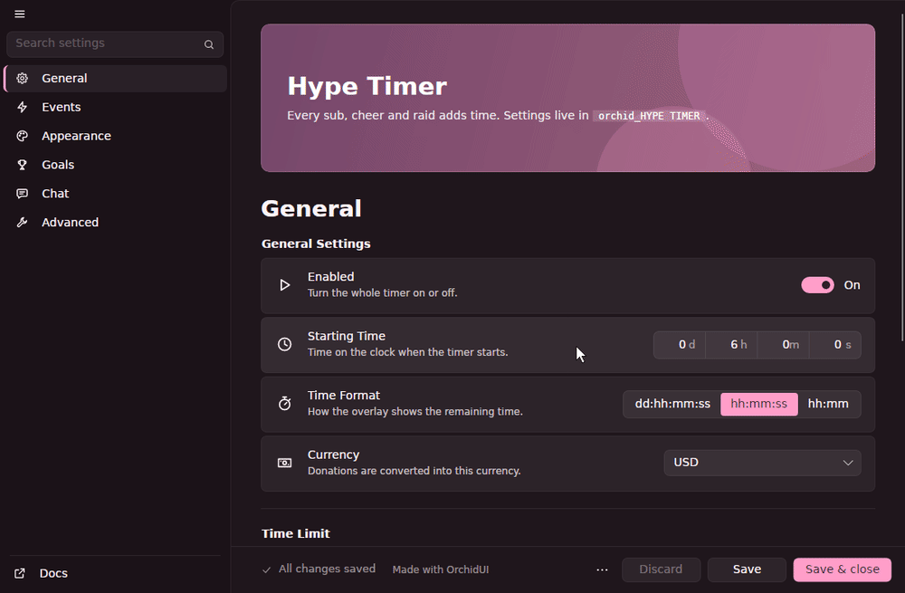

# OrchidUI

Settings windows for Streamer.bot C# actions, drawn natively on Windows, Linux and macOS.



[](https://github.com/AmeliaFromFinance/OrchidUI/actions/workflows/release.yml)
[](https://github.com/AmeliaFromFinance/OrchidUI/actions/workflows/ci.yml)
[](https://github.com/AmeliaFromFinance/OrchidUI/releases/latest)
[](LICENSE)

You describe the window in your action's code (`AddToggleSwitch`, `AddSlider`, `AddDropdown` and so on) and OrchidUI shows it, validates it and saves the values to a Streamer.bot global variable.

There are two parts. `OrchidUI.dll` is the library you reference from your action. It runs inside Streamer.bot, runs all your callbacks and does the saving. `orchid-host` is a small separate program that draws the window and reports what the user does. On Linux and macOS, Streamer.bot runs under Wine, but `orchid-host` runs natively, so the window gets your desktop's fonts, scaling and screen reader instead of Wine's. If the host crashes, Streamer.bot logs it and carries on; run the action again to reopen the window.

## Install

Download `OrchidUI.dll` and the host zip for your system from [Releases](https://github.com/AmeliaFromFinance/OrchidUI/releases/latest):

| Streamer.bot runs on | Host zip |
|---|---|
| Windows 10 or 11 | `orchid-host-win-x64.zip` |
| Linux (Wine, Bottles, Lutris, Proton) | `orchid-host-linux-x64.zip`, or `orchid-host-linux-arm64.zip` on ARM. See [docs/linux.md](docs/linux.md) |
| macOS (Whisky, CrossOver, Wine) | `orchid-host-osx-arm64.zip`. See [docs/macos.md](docs/macos.md) |

On Linux and macOS you want the Linux or macOS host, not the Windows one, even though Streamer.bot itself runs under Wine.

With Streamer.bot closed, put the DLL next to `Streamer.bot.exe` and unzip the host into a folder called `OrchidUI` beside it:

```
Streamer.bot/
  Streamer.bot.exe
  OrchidUI.dll
  OrchidUI/
    orchid-host        (orchid-host.exe on Windows)
```

On Linux and macOS, make the host executable (and on macOS, take it out of quarantine):

```bash
chmod +x OrchidUI/orchid-host
xattr -d com.apple.quarantine OrchidUI/orchid-host   # macOS
```

In your Execute C# Code sub-action, go to References > Add reference from file and pick `OrchidUI.dll`.

To check it works, run [`examples/3 - Minimal.cs`](examples/3%20-%20Minimal.cs). Streamer.bot's log should say something like `Settings window opened (Windows 11 (build 26100), ...)` or `Settings window opened (Wine on Linux, 127.0.0.1:45985)`.

The DLL and the host have to come from the same release. A release DLL only starts the host files it was built with and checks their SHA-256; anything else is refused with `isn't a build this OrchidUI.dll trusts`. Each release has a `SHA256SUMS` file, and you can verify where a download was built with `gh attestation verify orchid-host-linux-x64.zip --repo AmeliaFromFinance/OrchidUI`.

## Your first window

```csharp
using OrchidUI;

public class CPHInline
{
    public bool Execute()
    {
        if (Orchid.AlreadyOpened("SHOUTOUTS")) return true;

        var ui = new Orchid(CPH, "SHOUTOUTS", "1.0.0")
            .SetWindowSize(620, 520)
            .SetAutoSave(true);

        var tab = ui.Tab("Shoutouts", Icons.Megaphone);

        tab.AddToggleSwitch("Enabled", "Shout out raiders.", "enabled", true);
        tab.AddIntegerStepper("Min Raiders", "Smaller raids are ignored.", "minRaiders", 1, 1000, 5);
        tab.AddResponseBox("Message", "Variables: %user%", "message", "Go follow @%user%!");

        ui.ShowUI();
        return true;
    }
}
```

Most `Add*` methods take a label, a description and a key, then whatever that element needs. The key is the name the value is saved under, so use each one once per window.

The [examples](examples) folder has four complete actions: a settings window with most elements, tabs, conditions and validation; a runtime action that reads those settings; a minimal window; and one showing themes and window options.

## Elements

These are all called on a tab (`var tab = ui.Tab("Name", Icons.Settings);`). The last column is the type the value is saved as.

**Layout**

| Element | |
|---|---|
| `AddTitle(text)` | Section heading |
| `AddDescription(text)` | A paragraph. Supports `**bold**`, `` `code` ``, `%variables%` and `https://` links |
| `AddSeparator()` | A line between sections |
| `AddInfoBox(text, InfoKind.Warning)` | Coloured callout: `Info`, `Success`, `Warning` or `Danger` |

**Text**

| Element | | Saved as |
|---|---|---|
| `AddTextbox(label, desc, key, default, placeholder)` | One line of text | `string` |
| `AddPasswordBox(label, desc, key, default)` | Masked on screen and in logs, but saved as plain text | `string` |
| `AddTextArea(label, desc, key, default, lines)` | Several lines | `string` |
| `AddResponseBox(label, desc, key, default)` | Wide box for chat messages with `%variables%` | `string` |
| `AddCopyBox(label, desc, text)` | Read-only text with a copy button | not saved |

`AddCopyBox` also accepts a function, which runs again each time its tab is shown:

```csharp
tab.AddCopyBox("Command", "Paste this in chat.", () => "!so @" + ui.GetPendingValue<string>("name", ""));
```

**Choices**

| Element | | Saved as |
|---|---|---|
| `AddToggleSwitch(label, desc, key, default)` | On/off switch | `bool` |
| `AddSegmented(label, desc, key, options, defaultIndex)` | A row of buttons, pick one. Best for 2 to 6 options | `string` |
| `AddDropdown(label, desc, key, options, defaultIndex)` | Drop-down list | `string` |
| `AddRefreshableDropdown(label, desc, key, loader)` | Drop-down with a refresh button that reloads the options | `string` |
| `AddMultiSelect(label, desc, key, options, defaults)` | Pick several, shown as chips | `string[]` |

The options of a refreshable list come from a function that runs inside Streamer.bot, so it can use `CPH`. It runs when the field is added and again whenever the refresh button is clicked:

```csharp
tab.AddRefreshableDropdown("Reward", "Pick a channel point reward.", "reward",
    () => CPH.TwitchGetRewards().Select(r => r.Title));

// Or set the options yourself from a callback:
tab.AddRefreshableDropdown("Scene", "", "scene", new[] { "Main" }, () =>
    ui.UpdateDropdown("scene", LoadScenes()));

// A multi-select with a loader gets a refresh button too.
tab.AddMultiSelect("Rewards", "Each one adds time.", "rewards", () => CPH.TwitchGetRewards().Select(r => r.Title));
```

**Numbers, time and colour**

| Element | | Saved as |
|---|---|---|
| `AddSlider(label, desc, key, min, max, default)` | Slider with a number box | `int` |
| `AddSliderWithToggleSwitch(label, desc, key, min, max, default, enabledByDefault)` | Slider with an on/off switch | `int` and `bool` |
| `AddIntegerStepper(label, desc, key, min, max, default, step)` | Whole number with up/down buttons | `int` |
| `AddDecimalStepper(label, desc, key, min, max, step, default)` | Decimal with up/down buttons | `double` |
| `AddDurationPicker(label, desc, key, days, hours, mins, secs, showDays)` | Days, hours, minutes, seconds | `"dd:hh:mm:ss"`, read with `GetDuration` |
| `AddColorPicker(label, desc, key, "#9B5DE5", allowAlpha)` | Colour swatch and picker | `"#RRGGBB"` or `"#AARRGGBB"` |

A slider with a toggle saves two keys, the number under `key` and the switch under `key_enabled`:

```csharp
tab.AddSliderWithToggleSwitch("Bits", "Seconds per 100 bits.", "time_bits", 1, 3600, 60, true);
// Read back with cfg.GetInt("time_bits") and cfg.IsEnabled("time_bits")
```

**Lists and tables**

| Element | | Saved as |
|---|---|---|
| `AddTextList(label, desc, key, defaults, placeholder)` | A list of lines you can add to, reorder and remove from | `string[]` |
| `AddTable(label, desc, key, columns, defaultRows)` | Rows with typed columns | `string[][]` |
| `AddSelectionTextList(label, desc, key, choices, presets)` | Rows of a choice plus text | `string[][]` |
| `AddSelectionAmountTextList(label, desc, key, choices, presets)` | Rows of a choice, a number and text | `string[][]` |

Table columns can be text, numbers or choices. Every cell is saved as a string.

```csharp
tab.AddTable("Prizes", "What viewers can win.", "prizes",
    new[] {
        Column.Text("Prize", 2, "What they win"),   // header, width weight, placeholder
        Column.Number("Points", 0, 100000),        // header, min, max
        Column.Choice("Tier", new[] { "Bronze", "Gold" }),
    },
    new[] { new[] { "Sticker pack", "500", "Bronze" } });
```

Presets for the selection lists are one string per row, with `|` between cells:

```csharp
tab.AddSelectionAmountTextList("Goals", "", "goals",
    new[] { "Subs", "Bits" },
    new[] { "Subs|50|Cooking stream", "Bits|10000|Horror night" },
    "Counts", "Target", "Reward");   // optional column headers
```

**Files and images**

| Element | | Saved as |
|---|---|---|
| `AddFilePicker(label, desc, key, default, filter, startFolder, onAction, actionText)` | Path box with a Browse button that opens the system file dialog, and an optional second button | `string` |
| `AddFolderPicker(label, desc, key, default)` | The same for a folder | `string` |
| `AddImageInput(label, desc, key, default)` | A file path or `https://` URL, with a preview | `string` |

```csharp
tab.AddFilePicker("Backup", "Pick a backup, then Load.", "backupFile", "",
    "Backup files (*.json)|*.json",
    Path.Combine(Orchid.StreamerBotDirectory, "Backups"),
    () => LoadBackup(ui.GetPendingValue<string>("backupFile")),
    "Load");
```

Under Wine, a path picked in the dialog is saved the way Streamer.bot sees it (`Z:\home\you\...`), so `File.Exists` works on it.

**Buttons**

`AddButton(label, desc, buttonText, onClick, primary)` runs `onClick` inside Streamer.bot. `primary: true` gives it the accent colour.

```csharp
tab.AddButton("Test", "Sends a test message.", "Send", () =>
{
    CPH.SendMessage(ui.GetPendingValue<string>("message"));
    ui.ShowToast("Sent", InfoKind.Success);
});
```

`AddCustom(() => wpfElement)` still compiles, but only shows a placeholder: a WPF control can't be drawn by another program. It logs a warning and never calls your function.

## Modifiers

Every `Add*` returns a `Field`, and you can chain these onto it:

```csharp
tab.AddTextbox("API Key", "", "apiKey").Required().WithIcon(Icons.Key).ShowWhen("useApi", true);
```

| Modifier | |
|---|---|
| `.ShowWhen(key, value)` or `.ShowWhen(v => ...)` | Only shown while the condition holds |
| `.EnableWhen(key, value)` or `.EnableWhen(v => ...)` | Greyed out unless the condition holds |
| `.Required(message)` | Can't be empty |
| `.Validate(v => errorOrNull)` or `.Validate(v => bool, message)` | Your own rule |
| `.OnChange(v => ...)` | Runs when the user changes the value |
| `.WithFormat(v => text)` | How a slider's number is displayed |
| `.AsDuration()` | Displays a slider's seconds as `1m 30s` |
| `.WithPlaceholder(text)` | Hint text when empty |
| `.WithTooltip(text)` | Tooltip on the label |
| `.WithIcon(Icons.Star)` | Icon on the card |
| `.WithWidth(320)` | Width of the control in pixels |
| `.Stacked()` | Puts the control under its label instead of beside it |
| `.Collapsed()` | Lists and tables start folded, showing only the row count |

Conditions are re-checked whenever any value changes, using what's in the window (saved or not). Use `v.Get<T>(key)` to read a value and `v.IsTrue(key)` for a switch:

```csharp
tab.AddToggleSwitch("Time Limit", "", "limit_on", false);
tab.AddDurationPicker("Max Time", "", "limit_max", 1, 0, 0, 0).ShowWhen("limit_on", true);

tab.AddTextbox("Custom Level", "", "customLevel")
   .ShowWhen(v => v.Get<string>("level") == "Custom" && v.IsTrue("advanced"));
```

A failing `Required` or `Validate` turns the card red, shows the message and disables Save. Hidden fields aren't checked.

```csharp
tab.AddTextbox("Channel", "", "channel").Required("Enter your channel name.");

tab.AddTextbox("Port", "", "port", "8080")
   .Validate(v => int.TryParse((string)v, out var p) && p > 0 && p < 65536 ? null : "Port must be between 1 and 65535.");

tab.AddResponseBox("Reply", "", "reply").Validate(v => ((string)v).Length <= 500, "Twitch allows 500 characters.");
```

`OnChange` gets the new value and runs inside Streamer.bot, so it can use `CPH`:

```csharp
tab.AddToggleSwitch("Debug Mode", "", "debug", false)
   .OnChange(v => ui.ShowToast((bool)v ? "Debug on" : "Debug off"));
```

`WithFormat` and `AsDuration` only change what's shown. The saved value is still the number.

```csharp
tab.AddSlider("Volume", "", "volume", 0, 100, 50).WithFormat(v => v + " %");
tab.AddSlider("Cooldown", "", "cooldown", 0, 3600, 90).AsDuration();
```

## Window options

Call these on `ui` before `ShowUI()`:

```csharp
var ui = new Orchid(CPH, "HYPE TIMER", "1.2.0")
    .SetTheme("Synthwave")        // Orchid, Amethyst, Sakura, Synthwave, Graphite or Daylight
    .SetSubtitle("by PixelPancake")
    .AddHeaderText("Hype Timer", "Every sub adds time.")
    .AddLink("Docs", "https://example.com/docs")
    .SetFooterText("Need help? Ask in Discord.")
    .SetWindowSize(900, 640)
    .SetAutoSave(true);
```

Some others:

- `LoadThemeFile("my.json")` or `SetAccent("#FF66AA")` for your own colours
- `AddHeader(urlOrPath, height)` for a banner image
- `SetNavigation(NavigationStyle.Tabs)` for tabs along the top instead of a sidebar
- `ConfigureLayout(l => l.ShowImportExport = false)` to hide items in the menu next to Save (also `ShowResetAll` and `ShowAbout`)
- `ConfigureStrings(s => s.Save = "Speichern")` to translate the built-in text
- `RunActionOnSave("My Action")` or `ui.Saved += settings => ...` to react to saving

[docs/customisation.md](docs/customisation.md) lists every option.

While the window is open, from a button, an `OnChange` or another thread:

| Call | |
|---|---|
| `ui.GetPendingValue<T>(key)` | The value in the window right now, saved or not |
| `ui.GetValue<T>(key)` | The last saved value |
| `ui.SetValue(key, value)` | Sets a value and saves it immediately |
| `ui.UpdateDropdown(key, options, selectIndex)` | New options for a dropdown or multi-select |
| `ui.ShowToast(text, InfoKind.Success)` | A small popup in the corner |
| `ui.ShowMessage(title, text)` | A dialog with OK |
| `ui.ShowConfirm(title, text, "Yes", "No")` | Returns `true` or `false` |
| `ui.ShowChoice(title, text, "A", "B", "C")` | Returns the button's index, or `-1` if closed |
| `ui.Close()`, `ui.BringToFront()` | |
| `ui.LogSettings()` | Writes every value to the Streamer.bot log, passwords masked |

## Reading settings in other actions

Settings are saved as JSON in the persisted global variable `orchid_{NAME}`. In another action (with the DLL referenced there too):

```csharp
var cfg = OrchidSettings.Load(CPH, "HYPE TIMER");

bool on = cfg.GetBool("enabled", true);         // the second argument is the fallback
int seconds = cfg.GetInt("time_t1", 180);
bool t1On = cfg.IsEnabled("time_t1");          // a slider's switch
double mult = cfg.GetDouble("multiplier", 1);
string msg = cfg.GetString("chat_timeAdded");
TimeSpan start = cfg.GetDuration("startingTime");
string[] rewards = cfg.GetList("rewards");     // text lists and multi-selects
string[][] goals = cfg.GetRows("goals");       // tables and selection lists
```

Or without the DLL, since it's plain JSON:

```csharp
var cfg = Newtonsoft.Json.Linq.JObject.Parse(CPH.GetGlobalVar<string>("orchid_HYPE TIMER", true));
int secs = cfg["time_t1"]?.Value<int>() ?? 180;
```

## Things to know

- Password boxes are saved as plain text in Streamer.bot's global variables. They're only masked on screen and in logs.
- Add every field before calling `ShowUI()`. Fields added afterwards don't appear.
- A slider with a toggle also uses `key_enabled`, so don't use that key for anything else.
- Callbacks run inside Streamer.bot one at a time, and the window waits for them. Keep them quick, or start a `Task` for slow work.
- `ShowWhen(key, value)` compares loosely: `true`, `"true"` and `1` all match a switch that's on.
- `SetValue` saves straight away. Changes the user makes wait for Save, unless auto-save is on.
- Under Wine, a path picked in the file dialog is saved as `Z:\...`, but a path typed by hand is saved exactly as typed.
- Header images, fonts and window icons read from disk can be about 600 KB each (1 MiB in total). For a bigger banner, use an `https://` URL.

Keyboard shortcuts: `Ctrl+S` saves, `Ctrl+F` searches all settings, `Ctrl+1` to `Ctrl+9` and `Ctrl+Tab` switch tabs, `Ctrl` with `+`, `-` or `0` zooms, and `Esc` closes a dialog or clears the search. On macOS use `Cmd`. Every control has a name and description for screen readers.

## Troubleshooting

Start with Streamer.bot's log, then the host's log, which never contains setting values:

- Windows: `%LOCALAPPDATA%\OrchidUI\orchid-host.log`
- Linux: `~/.local/state/orchidui/orchid-host.log`
- macOS: `~/Library/Logs/OrchidUI/orchid-host.log`

| Streamer.bot's log says | What to do |
|---|---|
| `orchid-host wasn't found at ...` | The host has to be in `OrchidUI/` next to `Streamer.bot.exe`, or set `ORCHIDUI_HOST` to its full path |
| `isn't a build this OrchidUI.dll trusts` | The DLL and host are from different releases. Get both from the same one |
| `orchid-host hasn't connected 8 s after 'start /unix'` | Check the host log. If nothing new is there, your Wine is probably 9.5 to 10.0-rc2; see [docs/linux.md](docs/linux.md#if-the-window-never-appears) |
| `The settings window closed unexpectedly` | The host crashed or was killed. The host log says why. Run the action again |

On macOS, if the host log is empty or missing, the host is probably still quarantined (see Install).

These environment variables can be set for Streamer.bot (in Windows' system settings, or in Bottles, Lutris or Steam's launch options):

| Variable | |
|---|---|
| `ORCHIDUI_THEME` | A theme name or `.json` path, used by every OrchidUI window |
| `ORCHIDUI_SCALE` | Extra zoom, from `0.5` to `3` |
| `ORCHIDUI_ANIMATIONS` | `0` or `1` |
| `ORCHIDUI_BACKDROP` | `solid`, `mica`, `micaalt` or `acrylic` (Windows only) |
| `ORCHIDUI_HOST` | Full path to `orchid-host` |
| `ORCHIDUI_NO_LAUNCH` | `1` to not start the host, and wait for `orchid-host --watch` instead |
| `ORCHIDUI_TRANSPORT` | `pipe` or `tcp`, to override the automatic choice |
| `ORCHIDUI_SESSION_DIR` | Where session files go (must match `orchid-host --watch --dir`) |

## Building

You need the [.NET 10 SDK](https://dotnet.microsoft.com/download). Any OS can build everything, including the Windows DLL.

```bash
git clone https://github.com/AmeliaFromFinance/OrchidUI && cd OrchidUI
export AVALONIA_TELEMETRY_OPTOUT=1

dotnet build src/OrchidUI -c Release -f net481
# src/OrchidUI/bin/Release/net481/OrchidUI.dll

dotnet publish src/OrchidUI.Host -c Release -r linux-x64 --self-contained -p:DebugType=none -o dist/linux-x64
# dist/linux-x64/orchid-host (use win-x64, linux-x64, linux-arm64 or osx-arm64)
```

A DLL built like this is a development build. It starts whatever `orchid-host` it finds and logs `Development build of OrchidUI`, which is fine on your own machine. If you're going to share your build, pin it to your host files first, as described in [docs/building.md](docs/building.md).

To try things without Streamer.bot:

```bash
dotnet test --solution OrchidUI.slnx
dotnet run --project tools/orchid-sandbox -f net10.0 -- minimal          # an example with a fake Streamer.bot
dotnet run --project src/OrchidUI.Host -- --spec tests/fixtures/specs/settings.json   # draw a saved window description
```

## More

- [docs/customisation.md](docs/customisation.md): themes, fonts, window, layout, strings and icons
- [docs/linux.md](docs/linux.md) and [docs/macos.md](docs/macos.md): setup and problems specific to each
- [docs/building.md](docs/building.md): pinned builds and checksums for sharing your own build
- [docs/protocol.md](docs/protocol.md): how the DLL and the host talk to each other
- [SECURITY.md](SECURITY.md) and [CONTRIBUTING.md](CONTRIBUTING.md)

Planned: a `systemd --user` unit and a macOS LaunchAgent for `--watch`, native Wayland (it uses XWayland for now), a notarised macOS build and an Intel one, Flatpak and AUR packages for the host, and a cross-platform replacement for `AddCustom`.

## Licence

[MIT](LICENSE). Third-party notices are in [NOTICE](NOTICE).
